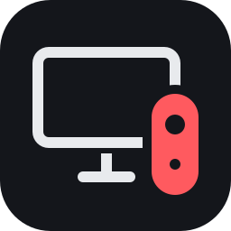

<p align="center">
  
</p>

<h1 align="center">SW2 Adapter</h1>

<p align="center">Use os controles do Nintendo Switch 2 no Windows: Joy-Con 2 (L, R ou em par), Pro Controller 2 e GameCube (NSO).</p>

---

O app conecta o controle por Bluetooth LE e cria um **DualShock 4 virtual** (via ViGEmBus), reconhecido pela Steam, jogos e emuladores.

## Destaques

- **Busca automática**: com o app aberto, aperte o sync. Controles conhecidos conectam sozinhos; os novos aparecem com o botão **Conectar**.
- **Reconexão em segundo plano**: se um controle cair, ele volta no mesmo controle virtual ao apertar o sync.
- **Seguro para o seu Switch 2**: nada é gravado nos controles. Comandos de pareamento, firmware e desligamento são bloqueados no código.
- **Cabo USB**: plugar o cabo só carrega o controle (ele desliga o Bluetooth sozinho), e o app avisa isso em vez de acusar queda.
- **Extras**: Joy-Cons L+R em par ou sozinhos (vertical/horizontal), calibração e zona morta, teste ao vivo, mouse óptico do Joy-Con 2, vibração, servidor DSU para giroscópio em emuladores, bateria com tempo restante estimado, interface em inglês e português, aviso de nova versão.

## Instalar

1. Instale o [ViGEmBus](https://github.com/nefarius/ViGEmBus/releases/latest).
2. Baixe o `SW2Adapter-<versão>-x64.msi` em [Releases](https://github.com/muryarth/sw2-joycons-adapter/releases) e execute.

O instalador deixa escolher a pasta e criar (ou não) o atalho na área de trabalho. O app aparece no menu Iniciar e na pesquisa do Windows. Para atualizar, basta rodar o MSI de uma versão mais nova: ele substitui a versão instalada.

Requer Windows 10/11 com Bluetooth LE. O ViGEmBus foi [aposentado pelo autor](https://docs.nefarius.at/projects/ViGEm/End-of-Life/), mas segue funcionando.

## Estrutura do repositório

```
core/      C++ portátil, sem headers de SO: protocolo, relatório DS4, traduções
windows/   app Windows (BLE WinRT, ViGEm, Dear ImGui/DX11) e instalador MSI
android/   app Android (planejado; vai reutilizar core/ via NDK)
assets/    ícone (SVG + ICO)
```

## Compilar

Requer Visual Studio 2022 com "Desenvolvimento para desktop com C++". O primeiro build baixa as dependências (Dear ImGui, nlohmann/json e ViGEmClient, em versões fixas), então precisa de internet uma vez.

```powershell
cmake -S . -B out/build -G "Visual Studio 17 2022" -A x64
cmake --build out/build --config Release
# out\build\windows\Release\sw2-adapter.exe
```

Instalador (requer .NET SDK e `dotnet tool install --global wix --version 5.0.2` + `wix extension add -g WixToolset.UI.wixext/5.0.2`):

```powershell
powershell -ExecutionPolicy Bypass -File windows\installer\build.ps1
# out\installer\SW2Adapter-<versão>-x64.msi
```

A versão vem de `windows/src/app/Version.h`. Configurações e log ficam em `%APPDATA%\sw2-joycons-adapter\`.

## Créditos

Baseado no **[joycon2cpp](https://github.com/TheFrano/joycon2cpp)**, de **TheFrano** (MIT), de onde vêm o protocolo e as sequências de inicialização validadas em hardware real. Referências de protocolo: [joycon2android](https://github.com/JoeGeC/joycon2android) e [switch2_controller_research](https://github.com/ndeadly/switch2_controller_research).

Bibliotecas: [Dear ImGui](https://github.com/ocornut/imgui), [nlohmann/json](https://github.com/nlohmann/json) e [ViGEmClient](https://github.com/nefarius/ViGEmClient), todas MIT.

Licença MIT. Veja [LICENSE](LICENSE).
